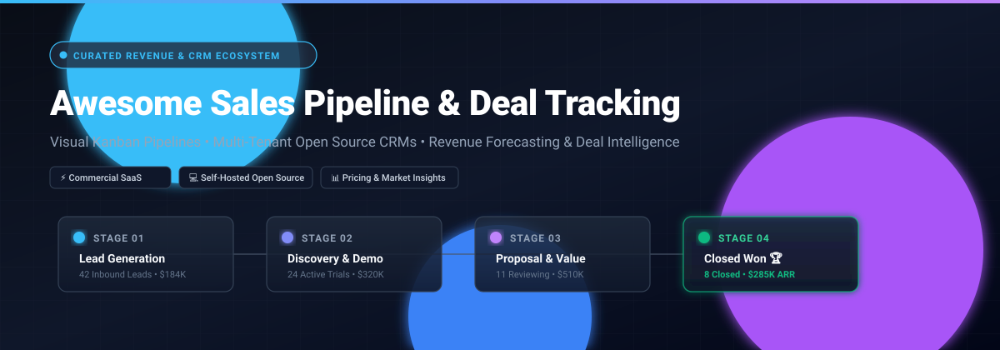
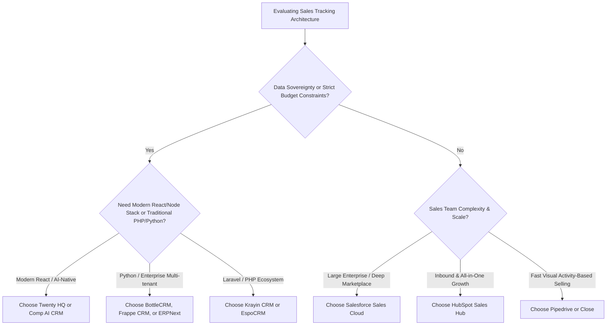

  

# 🚀 Awesome Sales Pipeline & Deal Tracking

  
  
  
  
  
  
  

> 🎯 A curated list of top **Sales Pipeline & Deal Tracking** software, visual Kanban CRM platforms, revenue intelligence systems, and self-hosted open-source CRM alternatives.

Whether managing high-velocity inbound funnels, tracking multi-stakeholder enterprise deals, or orchestrating self-hosted sales workflows, this repository aggregates the premier SaaS platforms and production-ready open-source codebases.

---

## 📑 Table of Contents

- [📊 Sector Overview & Market Dynamics](#-sector-overview--market-dynamics)
- [🏢 SaaS & Hosted Platforms](#-saas--hosted-platforms)
- [💻 Open-Source GitHub Projects](#-open-source-github-projects)
- [🧭 Key Selection Criteria: SaaS vs. Self-Hosted](#-key-selection-criteria-saas-vs-self-hosted)
- [🤝 How to Contribute](#-how-to-contribute)
- [💖 Support](#-support)
- [📈 Star History](#star-history)
- [⚖️ Disclaimer & License](#️-disclaimer--license)

---

## 📊 Sector Overview & Market Dynamics

The global CRM and Sales Pipeline Management software market is estimated at **$79.4 Billion in 2026** (projected to reach over $140 Billion by 2030 at a ~12.5% CAGR). The market structure is **moderately fragmented yet top-heavy**: while behemoths like Salesforce, Microsoft, and HubSpot anchor the core enterprise ecosystem (resembling an oligopoly at the global conglomerate tier), the mid-market and SMB domains feature intense specialization and fragmentation driven by agile Kanban-centric CRMs (Pipedrive, Close) and rapidly accelerating modern open-source, AI-native alternatives (Twenty, Frappe, Odoo).

---

## 🏢 SaaS & Hosted Platforms

Below is a comparison of premier commercial SaaS platforms for sales pipeline management, opportunity tracking, and revenue forecasting, **ranked descending by company valuation / annual revenue scale**:

| 🏢 Platform | 💰 Market Valuation / Annual Scale | 🏷️ Starting Tier Pricing | 🎁 Free Tier Limits / Trial Terms | ⚡ Core Focus & Differentiating Capabilities |
| :--- | :--- | :--- | :--- | :--- |
| **[Salesforce](https://www.salesforce.com/)** | ~$280B Market Cap (~$38B ARR) | **$25 / user / month** (*Starter Suite*, billed annually) | 30-day full-featured free trial; no permanent free plan. | Enterprise benchmark for complex deal tracking, custom stage lifecycles, and extensive AppExchange ecosystem. |
| **[HubSpot Sales Hub](https://www.hubspot.com/products/sales)** | ~$30B Market Cap (~$2.6B ARR) | **$15 / seat / month** (*Sales Hub Starter*, billed annually) | **100% Free Plan** with up to 5 users, 1 deal pipeline per account, contact management, and deal tracking. | Frictionless inbound sales orchestration, automated meeting scheduling, and unified marketing/support data sync. |
| **[monday Sales CRM](https://monday.com/crm)** | ~$14B Market Cap (~$950M ARR) | **$12 / seat / month** (*Basic CRM*, billed annually, 3-seat minimum) | 14-day full Pro trial; **Free Plan** available for up to 2 seats with up to 1,000 leads/items. | Highly customizable visual Work OS boards, drag-and-drop pipeline stages, and multi-team cross-functional collaboration. |
| **[Freshsales](https://www.freshworks.com/crm/sales/)** | ~$4.5B Market Cap (~$720M ARR) | **$9 / user / month** (*Growth*, billed annually) | **100% Free Plan** for up to 3 users with contact & deal management, visual pipeline, and built-in phone. | AI-powered Freddy sales insights, predictive lead scoring, built-in communication dialer, and multichannel tracking. |
| **[Zoho CRM](https://www.zoho.com/crm/)** | ~$1.4B ARR (~$15B Private Valuation) | **$14 / user / month** (*Standard*, billed annually) | **100% Free Plan** for up to 3 users with leads, documents, mobile app, and deal pipeline management. | Cost-effective comprehensive CRM, deeply integrated into Zoho's 50+ enterprise cloud applications and Zia AI assistant. |
| **[ActiveCampaign](https://www.activecampaign.com/)** | ~$3.5B Valuation (~$300M ARR) | **$19 / month** (*Starter*, billed annually for 1 user) | 14-day full-featured free trial (up to 100 contacts & 100 emails); no permanent free plan. | Deep marketing automation combined with automated deal progression, conditional deal routing, and contact lead scoring. |
| **[Pipedrive](https://www.pipedrive.com/)** | ~$1.5B Valuation (~$180M ARR) | **$14 / user / month** (*Lite*, billed annually) | 14-day free trial on any tier (no credit card required); no permanent free plan. | Clean, activity-based visual Kanban pipeline, deal rotting alerts, email sync, and predictable sales stage forecasting. |
| **[Copper](https://www.copper.com/)** | ~$400M Valuation (~$45M ARR) | **$9 / user / month** (*Starter*, billed annually) | 14-day full-featured free trial; no permanent free plan. | Native Google Workspace CRM embedded into Gmail and Google Calendar with automated deal logging. |
| **[Close](https://close.com/)** | ~$250M Valuation (~$30M ARR) | **$49 / user / month** (*Solo*, billed annually) | 14-day free trial (includes demo call/SMS credits); no permanent free plan. | Inside-sales productivity powerhouse with built-in multi-channel calling, two-way SMS, email sequences, and fast pipeline views. |
| **[Pipeline CRM](https://www.pipelinecrm.com/)** | ~$35M Valuation (~$8M ARR) | **$25 / user / month** (*Start*, billed annually) | 14-day full-access free trial; no permanent free plan. | Focused sales pipeline platform tailored for SMB sales teams wanting transparent deal visibility without enterprise bloat. |

---

## 💻 Open-Source GitHub Projects

Explore the top open-source CRM and sales pipeline engines, **ranked descending by GitHub star count**. Star badges link directly to the respective stargazers page:

| 📦 Repository & ⭐ Stars | 🛠️ Tech Stack | 📜 License | 💡 Description & Architectural Highlights |
| :--- | :--- | :--- | :--- |
| **[twentyhq/twenty](https://github.com/twentyhq/twenty)**    | TypeScript, NestJS, React, GraphQL, PostgreSQL | AGPL-3.0 | Modern open-source CRM alternative to Salesforce & HubSpot. Features Notion-style custom objects/fields, interactive visual Kanban boards, table filters, automated workflow triggers, and rich REST/GraphQL APIs. |
| **[odoo/odoo](https://github.com/odoo/odoo)**    | Python, JavaScript, PostgreSQL | LGPL-3.0 | World-renowned modular business platform with a comprehensive CRM module featuring drag-and-drop sales funnels, opportunity scoring, quotation generation, and deep enterprise app integration. |
| **[frappe/erpnext](https://github.com/frappe/erpnext)**    | Python, Frappe Framework, MariaDB | GPL-3.0 | Full-featured enterprise management suite with built-in Sales CRM: manage inbound leads, track multi-stage sales opportunities, automate quotation lifecycles, and coordinate field sales teams. |
| **[monicahq/monica](https://github.com/monicahq/monica)**    | PHP (Laravel), Vue.js, MySQL | AGPL-3.0 | Personal relationship management (PRM) system tailored for freelancers, solo founders, and consultants tracking deal interactions, conversation history, notes, and relationship milestones. |
| **[krayin/laravel-crm](https://github.com/krayin/laravel-crm)**    | PHP (Laravel), Vue.js, MySQL | MIT | Dedicated, lightweight open-source CRM built explicitly for SMEs. Delivers visual Kanban pipelines, custom attribute managers, lead management, and fast workflow automation. |
| **[trycompai/crm](https://github.com/trycompai/crm)**    | TypeScript, Next.js, Node.js | Apache-2.0 | Agentic-first, AI-native CRM designed for autonomous sales agents. Features interactive deals pipeline, contact intelligence, and programmatic control for automated outreach. |
| **[idurar/idurar-erp-crm](https://github.com/idurar/idurar-erp-crm)**    | Node.js, Express, React, MongoDB | MIT | Lightweight open-source ERP & CRM software package providing visual lead management, deals and offers tracking, client databases, and integrated invoicing for small business operators. |
| **[Dolibarr/dolibarr](https://github.com/Dolibarr/dolibarr)**    | PHP, JavaScript, MySQL/PostgreSQL | GPL-3.0 | Battle-tested modular enterprise suite offering comprehensive commercial prospect/customer tracking, sales opportunity workflows, quotation management, and POS integration. |
| **[salesagility/SuiteCRM](https://github.com/salesagility/SuiteCRM)**    | PHP, Symfony, Angular | AGPL-3.0 | The enterprise open-source standard (SugarCRM fork). Delivers customizable opportunity workflows, lead conversion, pipeline dashboards, document management, and quote generators. |
| **[frappe/crm](https://github.com/frappe/crm)**    | Python (Frappe), Vue 3, TailwindCSS | AGPL-3.0 | Modern, standalone CRM from Frappe with a lightning-fast visual Kanban interface, automated deal stage tracking, integrated telephony, and unified email communications. |
| **[espocrm/espocrm](https://github.com/espocrm/espocrm)**    | PHP, Backbone.js, MySQL | AGPL-3.0 | Highly customizable single-page web CRM. Features intuitive visual sales pipelines, dynamic custom fields, BPM/workflow engines, calendar synchronizations, and REST APIs. |
| **[django-crm/django-crm](https://github.com/django-crm/django-crm)**    | Python (Django REST), SvelteKit, Flutter | MIT | Multi-tenant CRM (BottleCRM) backed by PostgreSQL Row-Level Security. Complete lifecycle tracking: leads, opportunities, support tickets, invoices, OpenAPI schemas, and Flutter mobile apps. |
| **[relaticle/relaticle](https://github.com/relaticle/relaticle)**    | PHP (Laravel, Filament), PostgreSQL | AGPL-3.0 | Fast HubSpot/Pipedrive alternative built with Filament. Features team workspaces, deal stages, AI assistant for deal queries, and Model Context Protocol (MCP) server support for LLM integrations. |
| **[horilla/horilla-crm](https://github.com/horilla/horilla-crm)**    | Python (Django), Bootstrap | LGPL-2.1 | Combined HR & CRM platform providing role-based opportunity tracking, webhook automations, REST API endpoints, and multilingual support for cross-functional operations. |

---

## 🧭 Key Selection Criteria: SaaS vs. Self-Hosted

---

## 🤝 How to Contribute

Contributions are welcome and appreciated! To propose additions, updates, or corrections:

1. 🍴 **Fork** this repository.
2. 🌿 **Create a branch** for your feature or addition (`git checkout -b feature/add-new-crm`).
3. 📝 **Add or update** entries following the existing markdown table format:
   - Include specific starting prices and exact free tier limits for SaaS tools.
   - For open-source repos, include GitHub repo links, star badge, tech stack, and license.
4. 💾 **Commit and push** your changes cleanly.
5. 🚀 **Open a Pull Request** describing your additions with authoritative references.

---

## 💖 Support

If you found this curated list helpful, please consider showing your support:

- ⭐ **Star this repository** to help others discover it.
- 🍴 **Fork it** to customize your own sales stack benchmarks.
- 📢 **Share it** on Twitter/X, LinkedIn, or with your RevOps team.
- ☕ **Buy a coffee / Sponsor**: Support ongoing maintenance via the [GitHub Sponsors Dashboard](https://github.com/sponsors/ishandutta2007).

  

---

##  Star History

---

## ⚖️ Disclaimer & License

- 🛡️ This repository is a community-maintained guide and does not constitute commercial endorsement.
- 🔒 Sales pipeline and deal tracking platforms process sensitive customer financial and contact data. Always verify compliance with **GDPR**, **CCPA**, and **SOC-2** frameworks.
- ⚙️ When self-hosting open-source CRMs, administrators are responsible for infrastructure security, regular database backups, and patch management.

---

  Maintained with ❤️ by <a href="https://github.com/ishandutta2007">Ishan Dutta</a> and the open-source &amp; RevOps community. Star this repository if it helps your team close more deals!

